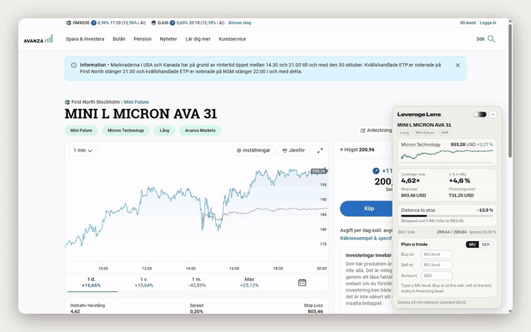
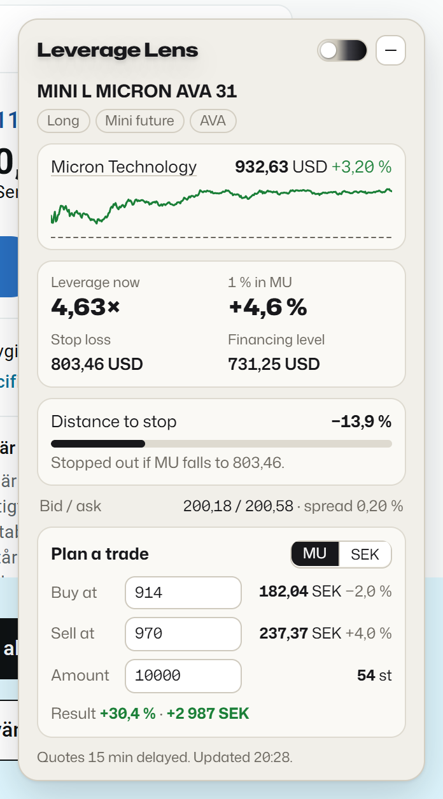
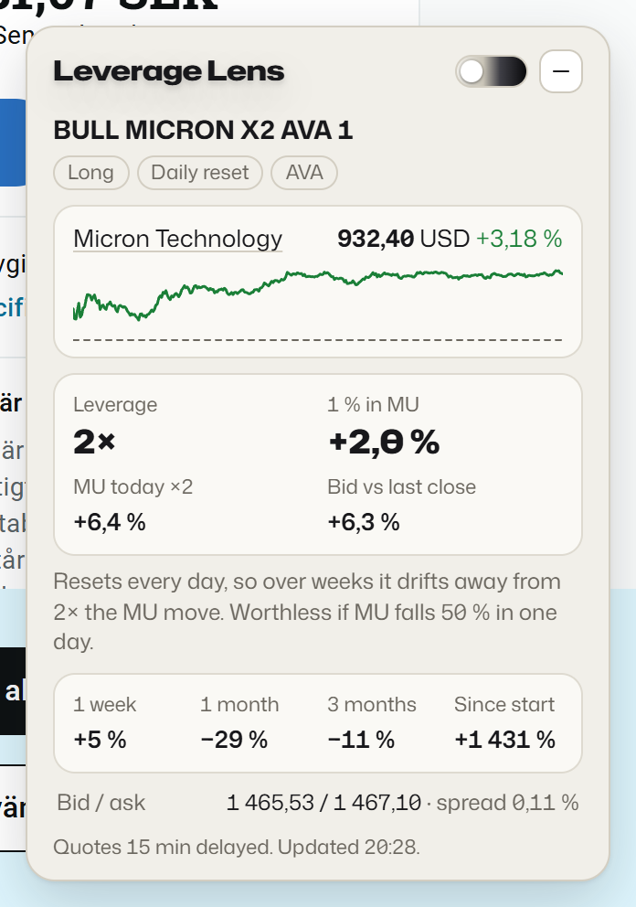
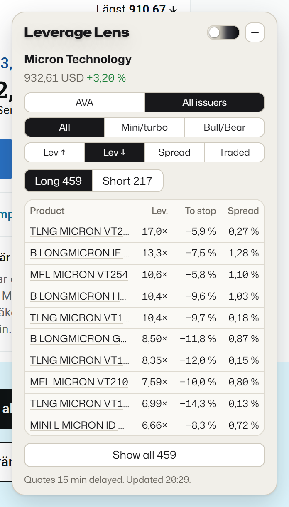
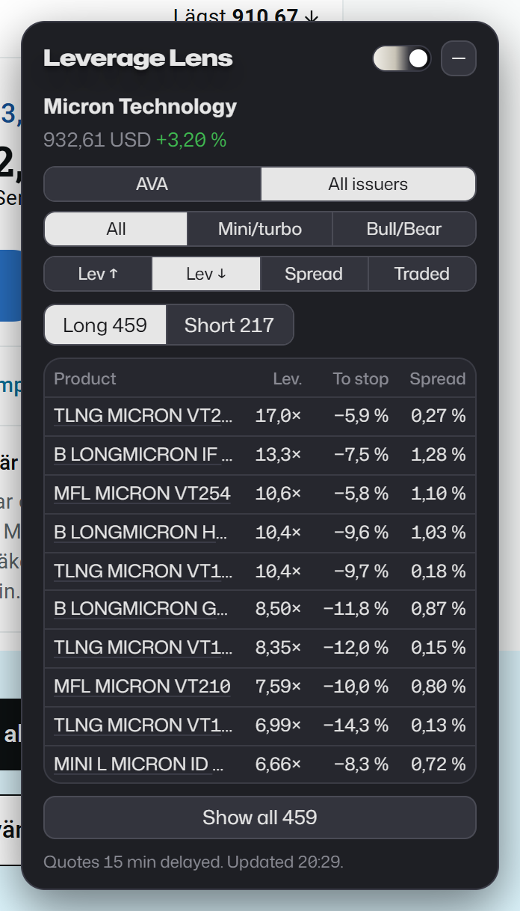

# Leverage Lens

A Chrome extension that adds a small card to Avanza's stock, index, mini future and BULL/BEAR pages. It shows the numbers you usually work out by hand: live leverage, distance to the stop, what a move in the stock does to the product, and what a mini will cost at the price you plan to buy and sell at.

## What it shows

| Mini future | BULL / BEAR | Stock or index |
|---|---|---|
|  |  |  |

**On a mini future or turbo**
- Leverage right now, worked out from the live price, and what 1 % in the underlying does to the mini
- Stop loss, financing level and how far the underlying is from the stop
- Today's chart of the underlying, with the stop line when it's close
- **Plan a trade:** type the underlying level you want to buy at and sell at (or the mini price), plus an amount. It shows the mini price at each level, with buy at the ask and sell at the bid, then how many units you get and the result in % and SEK.

**On a BULL/BEAR certificate**
- Leverage, the underlying's move today times the leverage, and the actual bid against yesterday's close
- 1 week, 1 month, 3 months and since start
- The one-day move that would wipe it out

**On a stock or index page** (Micron, Volvo, Guld, OMXS30 and others)
- Every mini, turbo and BULL/BEAR on it, long and short
- Buttons: **AVA / All issuers**, **All / Mini/turbo / Bull/Bear**, sort by **leverage up or down, spread or most traded**
- Leverage, distance to stop and spread for each one. Click a row to open it.

It refreshes every 30 seconds. When you're logged in to Avanza with real-time prices, the card is real-time too. Otherwise quotes are 15 minutes delayed and the card says so. A slider switches between light and dark, and the minus button tucks the card away.

## Install

1. Download this repo: **Code → Download ZIP**, then unzip it. Or grab `leverage-lens.zip` from [Releases](../../releases).
2. Open `chrome://extensions` (Edge: `edge://extensions`, Brave: `brave://extensions`).
3. Turn on **Developer mode**, click **Load unpacked** and pick the unzipped folder (the one with `manifest.json` in it).
4. Open any stock or mini on avanza.se. The card shows up in the bottom-right corner.

## How it works

Everything runs in your browser, on avanza.se only. The card reads the same price data that Avanza's own page loads, from Avanza's site, and it needs no permissions apart from saving your settings. It never places orders, never logs in for you and sends nothing anywhere else.

The mini prices come from how a mini future is priced: `(underlying − financing level) ÷ parity × exchange rate`. The exchange rate comes from the mini's own price right now. The financing level moves up a little every day and currencies move too, so a plan for a level several days out will be a little off.

## Not affiliated with Avanza

This is an independent hobby project and has nothing to do with Avanza Bank AB. The numbers are worked out from Avanza's public data and can be wrong or late. It is not investment advice. Check the order screen before you trade.

## License

MIT. The fonts in `fonts/` are Mona Sans and Hubot Sans by GitHub, under the SIL Open Font License.
